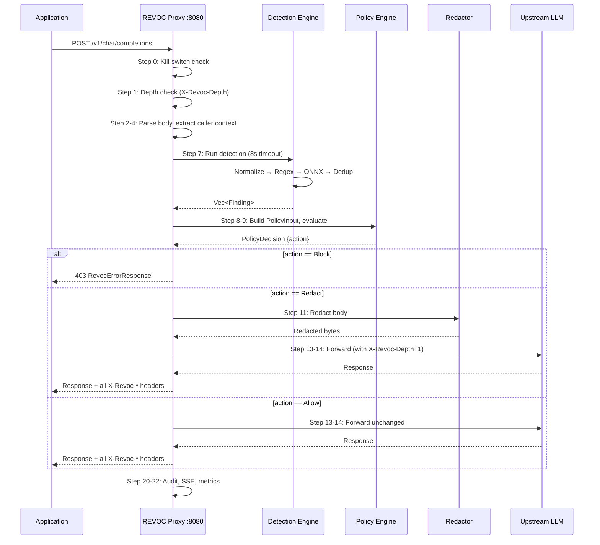

# Architecture

REVOC is a single Rust binary (`revoc-proxy`) containing nine crates assembled into
one process. No sidecar agents or background daemons are required in Tier 1 or Tier 2.

## Nine Crates

Dependencies flow in one direction only:

```
revoc-core → revoc-config → revoc-telemetry → revoc-detector →
revoc-pipeline → revoc-policy → revoc-redaction → revoc-dashboard → revoc-proxy
```

| Crate | Responsibility |
|---|---|
| `revoc-core` | Shared types (`Finding`, `PolicyDecision`, `CallerContext`), traits, error types |
| `revoc-config` | Configuration schema, TOML/YAML loading, environment variable overrides |
| `revoc-telemetry` | OTel tracer, Prometheus metrics, structured logging |
| `revoc-detector` | Detection engine: normalization, regex patterns, ONNX NER, manifest analyzer |
| `revoc-pipeline` | Orchestrates detection stages, deduplicates overlapping findings |
| `revoc-policy` | Policy evaluation: native engine (30 rules), OPA sidecar, WASM, caching |
| `revoc-redaction` | Body mutation: Remove / Mask / Hash strategies, JSON field targeting |
| `revoc-dashboard` | Embedded React SPA (served from `include_dir!`), SSE live feed, REST API |
| `revoc-proxy` | Axum HTTP server, all handlers, middleware, streaming, kill-switch, CLI |

## Request Lifecycle



## Port Layout

| Port | Purpose | Exposed to |
|---|---|---|
| 8080 | AI governance proxy (LLM + MCP) | Application |
| 3000 | Dashboard (React SPA + SSE + REST) | Operators |
| 8081 | Internal admin API (kill-switch, policies) | Trusted internal network only |
| 9090 | Prometheus metrics scrape endpoint | Monitoring |

!!! danger "Port 8081 must never be internet-facing"
    The kill-switch and policy admin endpoints on port 8081 are authenticated
    but must only be reachable from your internal network or management plane.

## Embedded Dashboard

The React SPA is compiled and embedded into the binary using `include_dir!`.
No separate web server, CDN, or filesystem access is required. The dashboard
serves from `:3000` by default and can be disabled with `dashboard_port = 0`.

## Storage Backends

| Tier | Audit storage | Policy cache | Kill-switch propagation |
|---|---|---|---|
| Tier 1 | SQLite (embedded) | In-process memory | Local only |
| Tier 2 / 3 | Postgres | Redis | Redis pub/sub (~50ms) |

## Security Model

- `#![forbid(unsafe_code)]` on all library crates
- Constant-time API key comparison (`subtle::ConstantTimeEq`)
- SSRF protection: upstream URL validated against configured allowlist only
- Header injection prevention: all header values pass through `sanitize_header_value()`
- No PII values stored: audit log records entity type + field + position only
