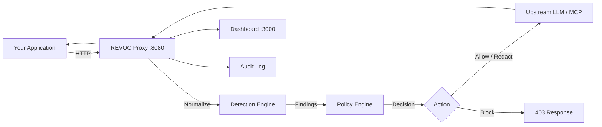

# REVOC — Runtime Execution Validation & Observability Control

**Govern every AI call your application makes. Zero code changes.**

REVOC is an out-of-band proxy that sits between your application and any LLM or MCP server.
Point `base_url` at `http://revoc:8080` and instantly get 30 active governance rules,
a live dashboard at `:3000`, and a full tamper-proof audit log.

---

## Three-Step Quickstart

**Step 1 — Start the proxy (single container, zero dependencies):**

```bash
docker run -d \
  -p 8080:8080 \
  -p 3000:3000 \
  -p 8081:8081 \
  -e OPENAI_API_KEY=$OPENAI_API_KEY \
  -e REVOC_AUTH__MODE=none \
  --name revoc \
  ghcr.io/revoc-ai/revoc:latest
```

!!! note "Authentication in production"
    `REVOC_AUTH__MODE=none` is for local development only. For production,
    use `REVOC_AUTH__MODE=apikey` and set `REVOC_API_KEYS=your-key` or point
    `REVOC_AUTH__API_KEYS_FILE` at a key file. See [Authentication](configuration/auth.md).

**Step 2 — Change one line in your application:**

```python
from openai import OpenAI

# Before
client = OpenAI(api_key="sk-...")

# After — 30 rules active, dashboard at :3000, full audit
client = OpenAI(api_key="sk-...", base_url="http://localhost:8080")
```

**Step 3 — Open the dashboard:**

```
http://localhost:3000
```

Every request appears in the live feed with full trace detail, decision, and timing breakdown.

---

## Architecture



---

## Feature Table

| Feature | REVOC | API Gateway | WAF |
|---|---|---|---|
| LLM-aware PII detection | ✅ | ❌ | ❌ |
| Secret exposure blocking | ✅ | ❌ | ❌ |
| Prompt injection detection | ✅ | ❌ | ❌ |
| MCP tool governance | ✅ | ❌ | ❌ |
| Unicode evasion normalization | ✅ | ❌ | ❌ |
| Emergency kill-switch (50ms) | ✅ | ❌ | ❌ |
| Infinite-loop depth guard | ✅ | ❌ | ❌ |
| Tool manifest analysis | ✅ | ❌ | ❌ |
| Bidirectional governance | ✅ | ❌ | ❌ |
| Shadow mode (observe-only) | ✅ | ❌ | ❌ |
| Zero application code changes | ✅ | ✅ | ✅ |
| HIPAA / PCI-DSS profiles | ✅ | ❌ | partial |
| P95 overhead < 10ms | ✅ | ✅ | ✅ |
| Collects telemetry / calls home | ❌ | varies | varies |

---

## Why REVOC

**Before REVOC:** Your application sends raw prompts containing PII to OpenAI. A prompt injection
in user-supplied data causes the model to exfiltrate a system prompt. A developer accidentally
commits an `AWS_SECRET_KEY` in a chat message. An autonomous agent enters an infinite recursive
loop, burning $300 in tokens before you notice.

**After REVOC:** Every one of those scenarios is blocked at the proxy layer before reaching the
model, with a full audit trail and an alert on the dashboard — without touching a single line
of application code.

!!! tip "No telemetry"
    REVOC makes zero outbound connections to revoc.io or any analytics endpoint.
    See [Telemetry Policy](security/telemetry-policy.md) for the complete list of outbound connections.
